<p align="center">
  
</p>

<p align="center">
  <a href="https://github.com/AliaJimenez">
    
  </a>
</p>

<p align="center">
  <a href="https://www.linkedin.com/in/aliandy-jim%C3%A9nez-595037318"></a>
  
  
</p>


## 🦒 About me · Sobre mí

**EN** — I'm a Software Development student at **ITLA** who enjoys building complete products: from the database and the API to the interface people actually click. My core is backend with **C# / .NET** and **Java**, and I ship frontends with **JavaScript & React**. I also like the DevOps side — CI/CD pipelines, Docker and Ansible — because good software should be easy to test and deploy.

**ES** — Soy estudiante de Desarrollo de Software en el **ITLA** y me gusta construir productos completos: desde la base de datos y la API hasta la interfaz que la gente usa. Mi fuerte es el backend con **C# / .NET** y **Java**, y desarrollo frontends con **JavaScript y React**. También disfruto el lado DevOps — pipelines CI/CD, Docker y Ansible — porque el buen software debe ser fácil de probar y desplegar.

```yaml
giraffe_mode:
  current_focus:  "Full-stack .NET + React · CI/CD"
  learning:       ["ASP.NET Core", "Cloud deployment", "Testing"]
  achievements:   ["NASA Space Apps 2026 — Heartbeat", "🏆 3rd place — BattleCode Arena (ITLA)"]
  fun_fact:       "Giraffes have been my favorite animal since I was a kid 🦒"
```


## 🌿 Tech stack · Tecnologías

<p align="center">
  <b>Backend</b><br/>
  <br/><br/>
  <b>Frontend</b><br/>
  <br/><br/>
  <b>Data · DevOps · Tools</b><br/>
  
</p>


## 🌳 Featured projects · Proyectos destacados

| Project | What it is · Qué es | Stack |
|---|---|---|
| 🛰️ **[Heartbeat](https://github.com/AliaJimenez/HeartbeatBackend)** | NASA Space Apps 2026 — astronaut self-assessment & Mission Control platform. Includes a [Galaxy Watch integration](https://github.com/AliaJimenez/HeartbeatWatch) for live heart rate. · *Plataforma de autoevaluación de astronautas y Mission Control.* | ASP.NET Core · Wear OS · FastAPI · PostgreSQL |
| 🗓️ **[NextSchedule ITLA](https://github.com/AliaJimenez/NextSchedule)** | Full-stack schedule planner: generates every valid class combination and exports your final timetable. Google sign-in. · *Planificador de horarios que genera combinaciones válidas de materias.* | ASP.NET Core 9 · Clean Architecture · CQRS · React · TypeScript · Tailwind |
| 📦 **[ImportCost Pro](https://github.com/AliaJimenez/ImportCost-Pro)** | Import management system with automated *landed cost* calculation. · *Gestión de importaciones y cálculo de costo real puesto en almacén.* | .NET 9 · ASP.NET Core MVC · EF Core |
| 🎓 **[Pensum Interactivo](https://github.com/AliaJimenez/Pensum-Interactivo)** · [live](https://pensumsinteractivositla.netlify.app/) | Interactive study-plan tracker for ITLA students. · *Pensums interactivos para planificar tu carrera en el ITLA.* | HTML · CSS · JavaScript · Netlify |
| ⚔️ **[BattleCode Arena](https://github.com/AliaJimenez/BattleCodeArena)** | 🏆 3rd place — RPG-style console game that assigns coding challenges. · *Juego RPG de consola que asigna retos de programación.* | C# · .NET 9 |
| 👨‍👩‍👧 **[ClassConnect](https://github.com/AliaJimenez/ClassConnect)** | Parent–teacher–student communication manager. · *Gestor de comunicación entre padres, maestros y estudiantes.* | Java · MySQL |
| ☕ **[Coffee Machine CI](https://github.com/AliaJimenez/maquina-cafe-cicd)** | TDD project with a GitHub Actions CI pipeline and Git Flow branching. · *Proyecto TDD con pipeline de CI.* | Java · Maven · JUnit · GitHub Actions |
| 🤖 **[Ubuntu Server Automation](https://github.com/AliaJimenez/ubuntu-server-automation)** | Infrastructure as Code lab: 5 Docker servers configured with Ansible. · *Laboratorio IaC con Docker y Ansible.* | Docker · Ansible · Linux |


## 📊 GitHub stats · Estadísticas

<p align="center">
  
  
</p>
<p align="center">
  
</p>


<p align="center">
  <i>"Stand tall, reach high, keep growing." 🦒</i><br/>
  <i>Gracias por visitar · Thanks for stopping by!</i>
</p>


